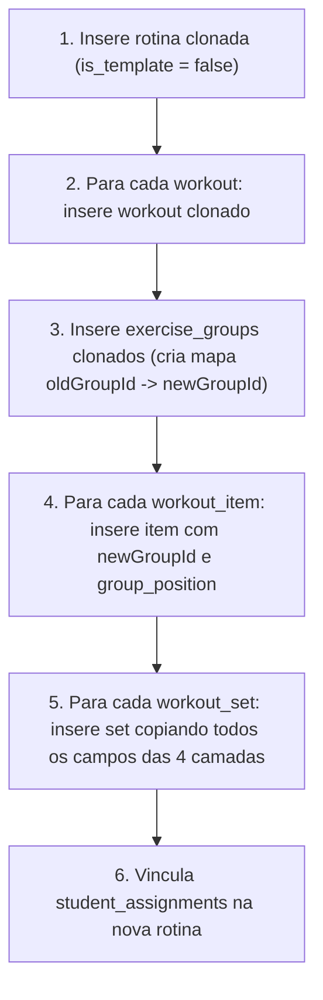

# Inteligência de Referência e Padrão de Arquitetura Técnica

- **Projeto / Domínio:** Fitcoach Pro (Plataforma Full-Stack de Prescrição, Periodização e Execução de Treinos Coach ↔ Aluno)
- **Perfil Detectado:** `full-stack` (React 19 + TypeScript + Tailwind CSS v4 + Supabase Postgres)
- **Feature Alvo:** Séries Especiais e Métodos de Intensificação (Taxonomia Ortogonal em 4 Camadas)
- **Data da Pesquisa:** 2026-10-12
- **Documentos Canônicos de Origem:** `PLANO_SERIES_ESPECIAIS.md` e `PLANO_SERIES_ESPECIAIS_COMPLEMENTO.md`

---

## 1. Stack e Compatibilidade de Versões

| Tecnologia | Versão Validada | Particularidades & Compatibilidade |
|---|---|---|
| **React** | `19.2.3` | Suporte a Actions, React Hooks modernos, ref assíncrono. Strict typing para callbacks. |
| **Tailwind CSS** | `4.1.18` | Configuração via `@import "tailwindcss";` e `@theme` em `index.css`. Variantes dark configuradas com `@custom-variant dark (&:where(.dark, .dark *));`. Zero necessidade de `tailwind.config.js`. |
| **Supabase Client** | `@supabase/supabase-js ^2.89.0` | Conexão autenticada via browser client e session pooler PostgreSQL (`pg: ^8.23.0`). |
| **Vite** | `6.2.0` | Fast refresh ESM, dynamic imports para code-splitting de modais. |
| **React Router** | `7.11.0` | Roteamento baseado em hooks (`useParams`, `useSearchParams`, `useNavigate`). |
| **Ícones / UI** | Google Material Symbols Rounded | Renderização via classes `<span className="material-symbols-rounded">...</span>`. |

---

## 2. Taxonomia Ortogonal em 4 Camadas

A arquitetura desacopla a complexidade de 40+ métodos práticos de musculação em **4 camadas ortogonais** combináveis entre si:

```
┌─────────────────────────────────────────────────────────────────┐
│                    WORKOUT_ITEMS (Exercício)                     │
│                                                                  │
│  Camada 1: AGRUPAMENTO          → group_id / group_type         │
│  (Quais exercícios são          → superset, triset, giant_set,  │
│   executados juntos?)              paired_antagonist            │
│                                                                  │
├─────────────────────────────────────────────────────────────────┤
│                    WORKOUT_SETS (Série)                           │
│                                                                  │
│  Camada 2: MÉTODO DE SÉRIE      → set_method                    │
│  (Como as séries se              → standard, dropset,           │
│   comportam entre si?)             rest_pause, cluster,         │
│                                    myo_reps, muscle_round,      │
│                                    method_3_7, fst7, bfr        │
│                                                                  │
│  Camada 3: EXECUÇÃO DO REP      → execution_mode + tempo        │
│  (Como cada repetição            → standard, tempo,             │
│   é executada?)                    pause_reps, deadstop,        │
│                                    ponto_zero,                  │
│                                    lengthened_partial,          │
│                                    twenty_ones, one_and_half,   │
│                                    negative, forced_reps        │
│                                                                  │
│  Camada 4: TIMER ENGINE          → timer_mode                   │
│  (Como o tempo é controlado?)    → standard, emom, amrap,       │
│                                    tabata                       │
│                                                                  │
└─────────────────────────────────────────────────────────────────┘
```

### 2.1 Detalhamento por Camada

1. **Camada 1: Agrupamento de Exercícios (`exercise_groups.group_type`)**
   - `superset` (Biset / Superset): 2 exercícios seguidos sem descanso (0s). Descanso ocorre após completar ambos.
   - `triset` (Triset): 3 exercícios em sequência sem descanso.
   - `giant_set` (Giant Set / Circuito): 4+ exercícios em sequência sem descanso.
   - `paired_antagonist` (Pareado Antagonista / APS): 2 exercícios que trabalham músculos opostos, intercalando descanso moderado configurado via `transition_seconds` (ex: 60-90s).

2. **Camada 2: Método de Série (`workout_sets.set_method`)**
   - `standard`: Série padrão.
   - `dropset`: Conclusão até próximo da falha → redução imediata de carga sem descanso. Configura `drop_count` (ex: 2 drops).
   - `rest_pause`: Série pesada → micro-pausa (`micro_rest_seconds`, default 15s) → continuação. Configura `sub_sets` (ex: 3).
   - `cluster`: Divisão de série pesada em blocos com micro-pausa (`micro_rest_seconds`, default 20s).
   - `myo_reps`: Série ativadora com `activation_reps` (12-20 reps) + mini-séries de 3-5 reps com micro-pausa de 5s.
   - `muscle_round`: Protocolo de Scott Stevenson — fixo: 6 mini-séries de 4 reps com 10s de micro-pausa.
   - `method_3_7`: Protocolo 3-4-5-6-7 reps com 15s de micro-pausa fixa.
   - `fst7`: 7 séries de 10-12 reps com descanso curto de 30-45s ao final do treino.
   - `bfr`: Restrição de fluxo (oclusão vascular) — 30-15-15-15 reps com 30s de descanso.

3. **Camada 3: Modo de Execução do Rep (`workout_sets.execution_mode`)**
   - `standard`: ROM total e cadência natural.
   - `tempo`: Cadência controlada via notação `tempo` (ex: "4-0-1-0": 4s excêntrica, 0s pausa inferior, 1s concêntrica, 0s pausa superior).
   - `pause_reps`: Pausa isométrica sob tensão de 2-3s no ponto de alongamento máximo a cada repetição.
   - `deadstop`: Repouso completo do peso nos suportes/chão por 1-2s a cada repetição (elimina energia elástica).
   - `ponto_zero`: Método Sardinha — contração isométrica estrita de 3-5s no ponto de estiramento máximo a cada repetição.
   - `lengthened_partial`: Repetições adicionais apenas na porção alongada do movimento após a falha.
   - `twenty_ones`: 21s (7 inferiores + 7 superiores + 7 completas).
   - `one_and_half`: Cada repetição é descer total + subir metade + descer total + subir total.
   - `negative`: Ênfase excêntrica lenta (4-8s) com carga supramáxima.
   - `forced_reps`: Assistência mínima de spotter para 2-4 reps extras além da falha.

4. **Camada 4: Timer Engine (`workout_sets.timer_mode`)**
   - `standard`: Descanso livre pós-série.
   - `emom`: Every Minute On the Minute (timer de 60s em contagem regressiva por round).
   - `amrap`: As Many Reps As Possible em uma janela de tempo fixa.
   - `tabata`: 8 rounds de 20s de esforço máximo / 10s de descanso.

---

## 3. Schemas DDL SQL, Alterações & RLS

### 3.1 Nova Tabela: `public.exercise_groups`

```sql
CREATE TABLE IF NOT EXISTS public.exercise_groups (
    id UUID PRIMARY KEY DEFAULT gen_random_uuid(),
    workout_id UUID NOT NULL REFERENCES public.workouts(id) ON DELETE CASCADE,
    group_type TEXT NOT NULL DEFAULT 'superset',
    group_order INTEGER NOT NULL,            -- Posição do grupo na sequência do treino
    rest_seconds INTEGER DEFAULT 90,         -- Descanso entre rounds completos do grupo
    rounds INTEGER DEFAULT 3,                -- Total de rounds a executar
    transition_seconds INTEGER DEFAULT 0,    -- 0 para superset/triset; 60-120 para paired_antagonist
    coach_notes TEXT,                        -- Notas gerais do grupo
    created_at TIMESTAMPTZ DEFAULT NOW(),

    CONSTRAINT exercise_groups_type_check 
        CHECK (group_type IN ('superset', 'triset', 'giant_set', 'paired_antagonist'))
);

CREATE INDEX IF NOT EXISTS idx_exercise_groups_workout 
    ON public.exercise_groups(workout_id, group_order);
```

### 3.2 Alterações em `public.workout_items`

```sql
ALTER TABLE public.workout_items
    ADD COLUMN IF NOT EXISTS group_id UUID REFERENCES public.exercise_groups(id) ON DELETE SET NULL,
    ADD COLUMN IF NOT EXISTS group_position INTEGER; -- Posição interna no grupo (1, 2, 3...)

CREATE INDEX IF NOT EXISTS idx_workout_items_group 
    ON public.workout_items(group_id, group_position);
```

### 3.3 Alterações em `public.workout_sets`

```sql
-- 1. Expansão de tipos de série (incluindo 'backoff')
ALTER TABLE public.workout_sets DROP CONSTRAINT IF EXISTS workout_sets_type_check;
ALTER TABLE public.workout_sets 
    ADD CONSTRAINT workout_sets_type_check 
    CHECK (type IN ('warmup', 'working', 'failure', 'drop', 'preparation', 'backoff'));

-- 2. Colunas de parametrização das 4 camadas
ALTER TABLE public.workout_sets
    ADD COLUMN IF NOT EXISTS set_method TEXT DEFAULT 'standard',
    ADD COLUMN IF NOT EXISTS micro_rest_seconds INTEGER,
    ADD COLUMN IF NOT EXISTS execution_mode TEXT DEFAULT 'standard',
    ADD COLUMN IF NOT EXISTS tempo TEXT,
    ADD COLUMN IF NOT EXISTS timer_mode TEXT DEFAULT 'standard',
    ADD COLUMN IF NOT EXISTS drop_count INTEGER,
    ADD COLUMN IF NOT EXISTS sub_sets INTEGER,
    ADD COLUMN IF NOT EXISTS activation_reps INTEGER;

-- 3. Check constraints de integridade
ALTER TABLE public.workout_sets DROP CONSTRAINT IF EXISTS workout_sets_method_check;
ALTER TABLE public.workout_sets
    ADD CONSTRAINT workout_sets_method_check
    CHECK (set_method IN (
        'standard', 'dropset', 'rest_pause', 'cluster',
        'myo_reps', 'muscle_round', 'method_3_7', 'fst7', 'bfr'
    ));

ALTER TABLE public.workout_sets DROP CONSTRAINT IF EXISTS workout_sets_execution_check;
ALTER TABLE public.workout_sets
    ADD CONSTRAINT workout_sets_execution_check
    CHECK (execution_mode IN (
        'standard', 'tempo', 'pause_reps', 'deadstop', 'ponto_zero',
        'lengthened_partial', 'twenty_ones', 'one_and_half',
        'negative', 'forced_reps'
    ));

ALTER TABLE public.workout_sets DROP CONSTRAINT IF EXISTS workout_sets_timer_check;
ALTER TABLE public.workout_sets
    ADD CONSTRAINT workout_sets_timer_check
    CHECK (timer_mode IN ('standard', 'emom', 'amrap', 'tabata'));
```

### 3.4 Alterações em `public.set_logs`

```sql
ALTER TABLE public.set_logs
    ADD COLUMN IF NOT EXISTS group_round INTEGER,
    ADD COLUMN IF NOT EXISTS set_method TEXT,
    ADD COLUMN IF NOT EXISTS micro_set_index INTEGER,
    ADD COLUMN IF NOT EXISTS execution_mode TEXT,
    ADD COLUMN IF NOT EXISTS tempo_used TEXT,
    ADD COLUMN IF NOT EXISTS timer_mode TEXT;

CREATE INDEX IF NOT EXISTS idx_set_logs_group_round 
    ON public.set_logs(workout_log_id, exercise_id, group_round);
```

### 3.5 Row Level Security (RLS) para `exercise_groups`

```sql
ALTER TABLE public.exercise_groups ENABLE ROW LEVEL SECURITY;

-- Coach: permissão ALL para gerenciar grupos dos treinos de suas rotinas
CREATE POLICY "Coach manage exercise groups" ON public.exercise_groups
FOR ALL TO authenticated
USING (
    workout_id IN (
        SELECT w.id FROM public.workouts w
        JOIN public.routines r ON w.routine_id = r.id
        WHERE r.coach_id = auth.uid()
    )
);

-- Aluno: permissão SELECT para ler grupos dos treinos de suas rotinas ativas
CREATE POLICY "Student read exercise groups" ON public.exercise_groups
FOR SELECT TO authenticated
USING (
    workout_id IN (
        SELECT w.id FROM public.workouts w
        JOIN public.routines r ON w.routine_id = r.id
        JOIN public.student_assignments sa ON sa.routine_id = r.id
        WHERE sa.student_id = auth.uid() AND sa.is_active = true
    )
);
```

---

## 4. Padrões de Arquitetura de Componentes UI (React 19 / Tailwind v4)

### 4.1 Coach Editor (`pages/coach/Editor.tsx` & `components/coach/editor/`)

1. **`ExerciseGroupCard.tsx` (Novo Container):**
   - Agrupa visualmente dois ou mais exercícios que possuem o mesmo `group_id`.
   - Exibe header destacado com badge `BISET` / `TRISET` / `GIANT SET` / `PAREADO ANTAGONISTA`.
   - Controles de descanso entre rounds (`rest_seconds`), total de rounds (`rounds`) e tempo de transição (`transition_seconds`).
   - Botão de desagrupar (move exercícios de volta para itens solo).
   - Reordenação interna dos exercícios alterando `group_position`.

2. **Modais de Configuração no Editor:**
   - `TypeSelectionModal.tsx`: Atualizado com a nova opção `'backoff'` (com badge e descrição explicativa).
   - `MethodSelectionModal.tsx` (Camada 2): Modal com catálogo de métodos, inputs dinâmicos de suporte (ex: `drop_count` se dropset; `micro_rest_seconds` e `sub_sets` se rest-pause/cluster; `activation_reps` se myo-reps).
   - `ExecutionModeModal.tsx` (Camada 3): Seleção do modo biomecânico (Ponto Zero, Pausa, Deadstop, etc.) e input formatado com máscara e validação para `tempo` (ex: `4-0-1-0`).
   - `TimerEngineModal.tsx` (Camada 4): Seleção de EMOM / AMRAP / Tabata quando desejado.

3. **Ordem Estrita de Persistência no `handleSave` (`Editor.tsx`):**
   - **Passo 1 (Grupos Removidos):** Deleta de `exercise_groups` os grupos cujo ID não consta mais na lista atual do treino.
   - **Passo 2 (Salvar Grupos):** Salva (insert/upsert) os `exercise_groups`, mapeando IDs temporários (`temp-group-...`) para os UUIDs reais retornados pelo Supabase em um `groupIdMap = new Map<string, string>()`.
   - **Passo 3 (Salvar Itens):** Salva `workout_items`, atribuindo `group_id: item.group_id ? (groupIdMap.get(item.group_id) || item.group_id) : null` e `group_position`. Mapeia em `itemIdMap`.
   - **Passo 4 (Salvar Séries):** Salva `workout_sets` com `workout_item_id` remapeado, persistindo todos os novos atributos (`set_method`, `execution_mode`, `tempo`, etc.).

4. **`WorkoutImportModal.tsx`:**
   - Durante a importação de exercícios de outra rotina ou aluno, detecta e preserva agrupamentos, recriando novos `exercise_groups` quando 2 ou mais exercícios de um mesmo grupo forem importados juntos.

---

### 4.2 Execução do Aluno (`pages/student/WorkoutExecution.tsx`)

1. **Renderização de Grupos:**
   - Card unificado com borda lateral com cor de grupo (índigo `#6366f1`).
   - Cabeçalho do grupo informando o round atual e total (ex: `Round 1 de 3`).
   - Exercícios empilhados no round com conector visual "↕ execute imediatamente sem descanso" (ou tempo de transição se `paired_antagonist`).
   - Check individual de cada exercício por round.

2. **Regras de Ouro do Relógio e Timers:**
   - **Regra de Grupo:** Ao dar check no Exercício 1 de um Biset, o timer de descanso principal **NÃO DISPARA**. Apenas avança o foco visual para o Exercício 2. O timer de descanso entre rounds (`exercise_groups.rest_seconds`) só dispara quando o aluno dá check no último exercício do grupo para aquele round.
   - **Regra de Dropset:** O timer de descanso só dispara após o check do último drop configurado.
   - **Regra de Micro-Timers (Rest-Pause, Cluster, Myo-Reps, Muscle Round):**
     - Ao concluir um sub-set intermediário, dispara o **micro-timer** com duração de `micro_rest_seconds` (ex: 15s).
     - Mostra um timer compacto, visualmente diferenciado do descanso normal, com contagem regressiva e aviso sonoro sutil.
     - O descanso principal entre séries normais só dispara ao concluir o último sub-set do bloco.

3. **Sistema de Ajuda Contextual ("?" Help System):**
   - Todos os badges de método (`DROPSET ?`, `REST-PAUSE ?`, `PONTO ZERO ?`, `BISET ?`) são botões clicáveis.
   - Ao tocar, abrem o `MethodGuideModal.tsx` exibindo explicação acessível, instrução biomecânica passo a passo e dicas em linguagem amigável (PT-BR).

---

## 5. Padrão de Deep Clone de Rotinas (`pages/coach/Library.tsx`)

Ao atribuir uma rotina template a um aluno, o Fitcoach realiza a clonagem profunda mantendo as relações de integridade:



### Mapeamento de Atributos no Clone de Séries:
```typescript
const setsToInsert = item.workout_sets.map((s: any) => ({
    workout_item_id: newItem.id,
    type: s.type,
    reps_target: s.reps_target,
    weight_target: s.weight_target,
    rest_seconds: s.rest_seconds,
    rpe_target: s.rpe_target,
    set_order: s.set_order || s.order_index,
    // NOVOS CAMPOS COPIADOS FIELMENTE:
    set_method: s.set_method || 'standard',
    micro_rest_seconds: s.micro_rest_seconds,
    execution_mode: s.execution_mode || 'standard',
    tempo: s.tempo,
    timer_mode: s.timer_mode || 'standard',
    drop_count: s.drop_count,
    sub_sets: s.sub_sets,
    activation_reps: s.activation_reps
}));
```

---

## 6. Persistência Offline e Stale Workout Service

### 6.1 `utils/offlineSyncService.ts`
Expansão do contrato `OfflineSetLog` para sincronização quando offline:
```typescript
export interface OfflineSetLog {
    exercise_id: string;
    set_type: string;
    set_order: number;
    weight_kg: number;
    reps_completed: number;
    rpe_actual: number | null;
    time_completed?: number | null;
    distance_completed?: number | null;
    speed_actual?: number | null;
    hiit_cycles_completed?: number | null;
    // RASTREABILIDADE DE SÉRIES ESPECIAIS:
    group_round?: number | null;
    set_method?: string | null;
    micro_set_index?: number | null;
    execution_mode?: string | null;
    tempo_used?: string | null;
    timer_mode?: string | null;
}
```

### 6.2 `utils/staleWorkoutService.ts`
As interfaces `SavedSet` e `SavedExercise` passam a suportar as propriedades de agrupamento (`group_id`, `group_position`) e sub-séries (`micro_set_index`, `set_method`), garantindo que se o aluno abandonar o treino após 4 horas, o detector de treino stale calcule as métricas e envie os logs completos ao Supabase sem perder os metadados especiais.

---

## 7. Pitfalls Técnicos Mapeados & Mitigações

1. ⚠️ **Race Condition no Salvamento do Editor (`Editor.tsx`):**
   - *Risco:* Se `handleSave` for acionado simultaneamente por auto-save debounced e clique manual, IDs temporários podem ser duplicados no banco.
   - *Mitigação:* Usar a trava `isSavingRef.current` já presente e limpar imediatamente `saveTimerRef.current` no início da operação de save.

2. ⚠️ **Ordem de Dependência de Chaves Estrangeiras:**
   - *Risco:* Tentar salvar `workout_items` referenciando `group_id` antes de persistir e receber os IDs de `exercise_groups` gerará erro de FK violation (`violates foreign key constraint`).
   - *Mitigação:* Estruturar o salvamento em 3 passos sequenciais: 1º salvar grupos e popular `groupIdMap`, 2º salvar itens substituindo IDs de grupo, 3º salvar sets.

3. ⚠️ **Disparo Acidental de Timer no Meio do Superset:**
   - *Risco:* O aluno clica no check do primeiro exercício do biset e o timer principal de 90s começa a contar, confundindo a execução.
   - *Mitigação:* No handler `toggleSetCompletion`, verificar se o item possui `group_id`. Se sim, verificar se todos os exercícios do round foram completados. Se não foram, **não invocar `startRestTimer`** (ou invocar apenas a transição rápida se configurada).

4. ⚠️ **Backwards Compatibility e Exercícios Solo:**
   - *Risco:* Quebrar o fluxo padrão de treinos normais que não usam métodos de intensificação.
   - *Mitigação:* Todos os novos campos SQL são `NULL` por padrão ou possuem `DEFAULT 'standard'`. O código trata `group_id === null` ou ausência de métodos mantendo 100% da lógica original.

---

## 8. Status de Skills Especializadas

| Tecnologia Especializada | Status da Skill | Localização |
|---|---|---|
| **Supabase** | Disponível | `.agents/skills/supabase/` |
| **PostgreSQL Best Practices** | Disponível | `.agents/skills/supabase-postgres-best-practices/` |
| **Impeccable Design / UI** | Disponível | `.agents/skills/impeccable/` |
| **Workout Prescriber** | Disponível | `.agents/skills/workout-prescriber/` |
| **Tailwind CSS v4** | Suportada nativamente | Configurada via `@theme` em `index.css` |

Nenhuma tecnologia especializada ausente. Todas as convenções necessárias estão mapeadas e disponíveis para o Gauntlet Builder.

---

## 9. Veredito do Stage 1 (Reference Scout)

✅ **Inteligência de Mercado e Referência Técnica CONCLUÍDA com sucesso.**
- `docs/gauntlet/REFERENCIAS.md` compilado e consistente com os planos aprovados.
- `docs/gauntlet/TOKENS.json` extraído e padronizado com especificações DTCG.
- Todas as dependências e contratos de engenharia mapeados para liberação imediata do **Stage 2: Gauntlet Builder**.
